# Сервер в облаке Cloud.ru (Сбера) на приветственные бонусы

> То же самое с картинками и отметками шагов: **[mc-panel.space/guide](https://mc-panel.space/guide/)**.

Пошаговая инструкция по кнопкам, как получить виртуальный сервер в облаке **Cloud.ru Evolution** и оплатить его приветственными бонусами. Дальше идёт обычная [установка панели](INSTALL.md).

> **Сначала главное, чтобы не было сюрпризов:**
> - Нужна **банковская карта** (её просят привязать при регистрации, без неё дальше не пустят).
> - Бонусы **не бесконечные**: «Тест Evolution» на 4000 бонусов (Б) действует примерно 2 месяца (в нашем кабинете: с 23 октября по 22 декабря). Сколько хватит, зависит от мощности сервера: чем он мощнее, тем быстрее тратятся бонусы.
> - Пока баланс не активирован (первое пополнение), вы платите **только бонусами**, а когда они закончатся, ресурсы приостанавливаются. Подробности и условия смотрите в самом кабинете (баланс → «Контроль затрат»), они могут меняться.
>
> Названия кнопок записаны с кабинета на 1 ноября 2026 года. Интерфейс облака обновляется, ориентируйтесь на смысл.

---

## Шаг 1. Регистрация (Сбер ID не нужен)

1. Откройте **[console.cloud.ru](https://console.cloud.ru/)**.
2. На странице входа нажмите **«Зарегистрироваться»** и создайте аккаунт по **почте и паролю** (Cloud.ru ID). Кнопки «Сбер ID», «GigaID», «Т-Банк», «Passkey» ниже на этой странице необязательны: можно обойтись без них.
3. Следуйте шагам регистрации и **привяжите банковскую карту**, когда сервис её попросит.
4. После входа вы попадёте на главную страницу «Платформа Cloud.ru Evolution», внутри проекта «Новый Проект».

**Проверьте бонусы.** Вверху справа видна плашка баланса: `0 ₽` и зелёная метка с бонусами (например `2 255 Б`). Нажмите на неё, откроется окно **«Контроль затрат»**: в блоке **«Гранты»** будет строка **«Тест Evolution (4 000 Б)»** с остатком и датами действия.

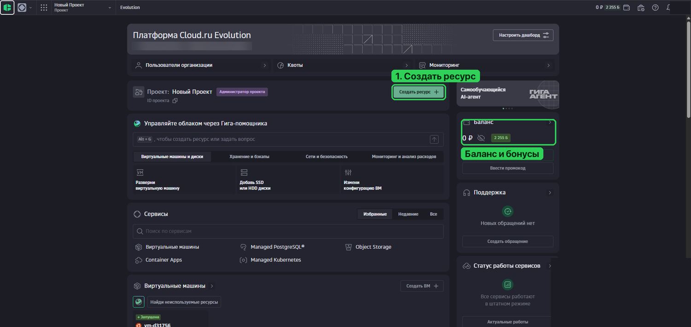

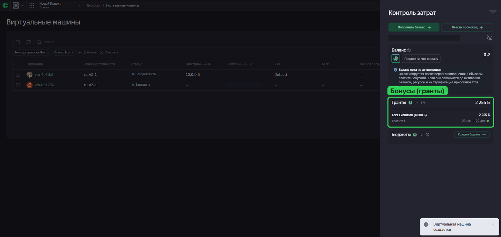

---

## Шаг 2. Создайте виртуальную машину

На главной странице нажмите **«Создать ресурс +»** → **«Виртуальная машина»** (или кнопку **«Создать ВМ +»** в блоке «Виртуальные машины» ниже). Откроется форма «Создание виртуальной машины» из двух шагов: **1 Конфигурация** и **2 Настройки**.

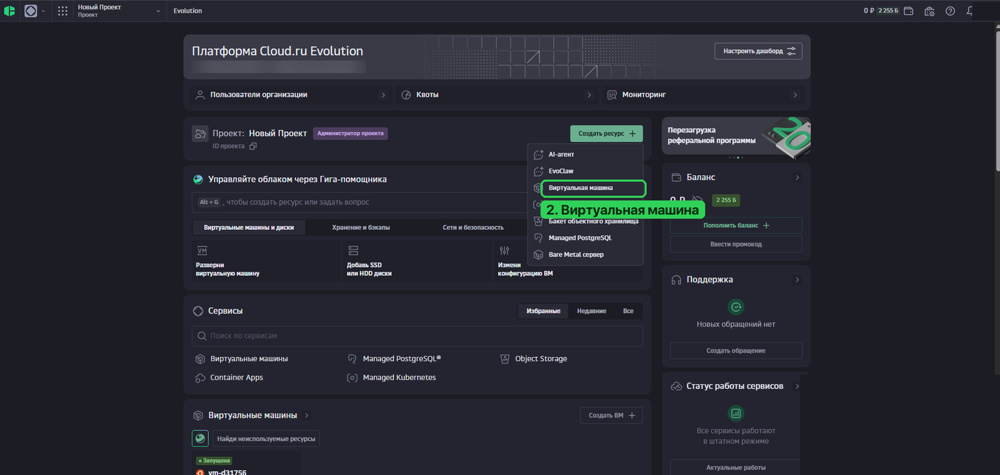

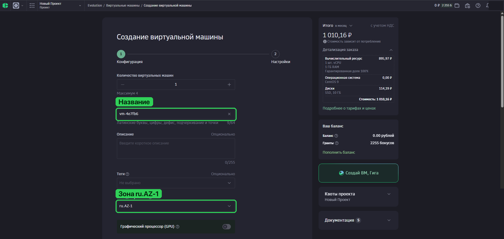

### Шаг 1 из 2: «Конфигурация»

| Поле | Что выбрать |
|---|---|
| **Количество виртуальных машин** | 1 |
| **Название** | любое (латиница, цифры, дефис), например `minecraft` |
| **Зона доступности** | оставьте `ru.AZ-1` |
| **Графический процессор (GPU)** | выключен |
| **Образ** | вкладка **«Публичные ОС»** → **Ubuntu 24.04** (по умолчанию выбрана CentOS 9, **смените её!** Подойдёт и Ubuntu 22.04) |
| **Диски** → размер | **40 ГБ** (минимум 20 ГБ), тип **SSD** |
| **Вычислительный ресурс** | вкладки **Dedicated / Balanced / Shared**; **vCPU: 2**; **RAM: 4 ГБ** (минимум 2 ГБ) |

Справа в блоке **«Итого в месяц»** видна цена. Для примера: самая слабая машина (1 vCPU, 1 ГБ RAM, 10 ГБ SSD, вкладка Dedicated) стоит около **1010 ₽ в месяц**. Нужна дешевле? Попробуйте другие вкладки («Balanced», «Shared») и смотрите, как меняется итог. Для Minecraft-панели не берите меньше 2 ГБ памяти.

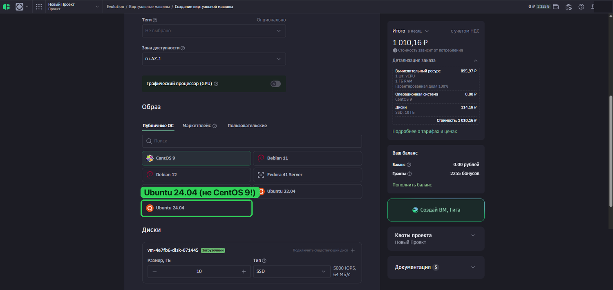

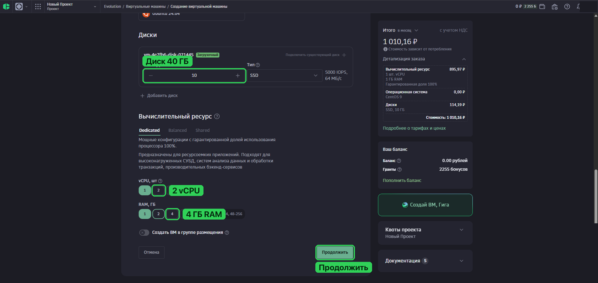

Нажмите **«Продолжить»**.

### Шаг 2 из 2: «Настройки»

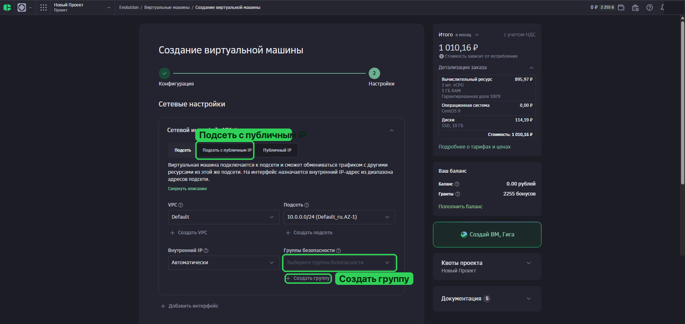

**Сетевые настройки → «Сетевой интерфейс №1».** Вверху есть три вкладки: **«Подсеть»**, **«Подсеть с публичным IP»**, **«Публичный IP»**. Выберите **«Подсеть с публичным IP»**: без публичного IP до сервера не достучаться из интернета (если не уверены, выбирайте её). Остальное оставьте: VPC `Default`, подсеть `10.0.0.0/24`, внутренний IP «Автоматически».

**Группы безопасности** (порты) настраиваются ниже, в [шаге 3](#шаг-3-откройте-порты). Можно пока оставить поле пустым и создать группу кнопкой **«Создать группу»** под ним.

**Авторизация пользователя:**
- **Логин**: оставьте `user1` (под ним вы будете входить на сервер).
- **Метод аутентификации**: **«Пароль»** (проще всего для новичка; по нему вы входите через **виртуальную консоль**, подробнее в шаге 5). Придумайте **длинный надёжный пароль** и запомните его. Облако рекомендует **«Публичный ключ»**: это надёжнее, но сложнее.

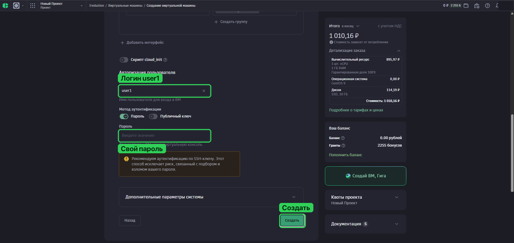

Нажмите **«Создать»**. Машина создаётся 1-3 минуты.

---

## Шаг 3. Откройте порты

Без этого панель не откроется, а друзья не смогут зайти на Minecraft-сервер.

1. В «Шаге 2 из 2» формы создания машины под полем **«Группы безопасности»** нажмите **«Создать группу»** (или позже через поиск по сервисам: раздел **«Группы безопасности»** → **«Создать группу безопасности +»**).
   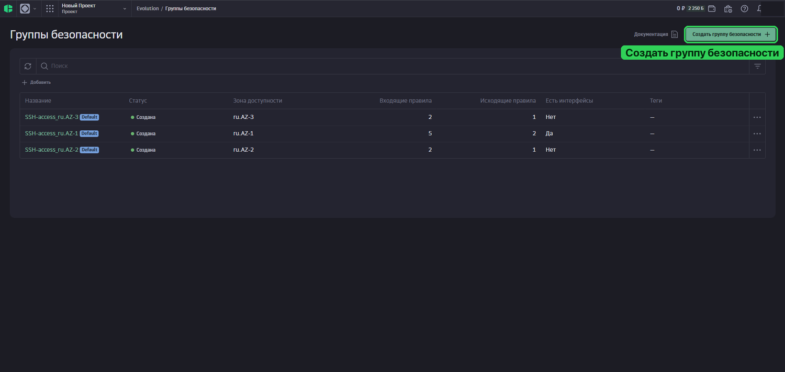

2. Откроется форма **«Создание группы безопасности»**: придумайте название (по умолчанию подставлено `sg-123456`), зона `ru.AZ-1`.
3. В блоке **«Правила входящего трафика»** нажимайте **«+ Добавить правило»** и добавьте входящие разрешения (если спросит источник, укажите любой адрес, `0.0.0.0/0`):

   | Порт | Протокол | Зачем |
   |---|---|---|
   | **22** | TCP | вход на сервер по SSH |
   | **80** | TCP | сайт панели |
   | **443** | TCP | сайт панели по HTTPS |
   | **25565-25665** | **TCP и UDP** | сами Minecraft-серверы (два правила: TCP и UDP) |

4. Появится жёлтое предупреждение: *«Добавленные правила блокируют работу ресурсов. Разблокируйте системный трафик при помощи кнопки ниже…»*. **Нажмите эту кнопку** под предупреждением, иначе у машины может пропасть сеть.
5. Сохраните группу и выберите её в поле **«Группы безопасности»** вашей машины.

   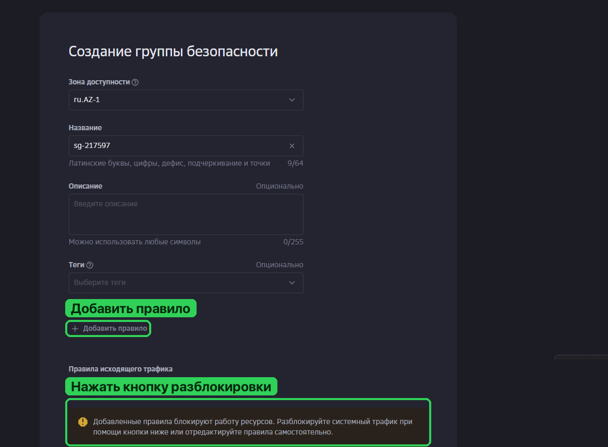

> В облаке уже есть готовая группа **«SSH-access_ru.AZ-1» (Default)**, она пускает только SSH. Если используете её, добавьте в неё остальные правила из таблицы вместо создания новой группы.

---

## Шаг 4. Найдите IP-адрес

1. Откройте **«Сервисы»** → **«Виртуальные машины»** (или блок «Виртуальные машины» на главной странице).
2. Дождитесь, пока статус изменится с «Создаётся N%» на **«Запущена»**.
3. В списке в колонке **«Публичный IP»** будет адрес вашей машины (четыре числа через точки). **Запишите его.**

В карточке машины (нажмите на её название) слева есть разделы: **«Информация»**, **«Сетевые параметры»**, **«Диски»**, **«Резервные копии»**, **«Мониторинг»**, **«Настройки авторизации»**, **«Виртуальная консоль»**, **«Серийная консоль»** (в тестовом режиме).

---

## Шаг 5. Подключитесь к серверу

В облаке вход идёт не под `root`, а под пользователем **`user1`** (тот логин, что вы оставили в форме).

> **Важно:** на образах Cloud.ru вход по SSH **с паролем отключён** (проверено на практике: сервер принимает только SSH-ключи). Поэтому самый простой путь для новичка: **виртуальная консоль в браузере**.

### Способ 1 (проще всего): виртуальная консоль в браузере

1. **«Виртуальные машины»** → нажмите на название вашей машины.
2. В левом меню откройте **«Виртуальная консоль»**.
3. Введите логин `user1` и пароль, который задали при создании (символы при вводе не отображаются, это нормально).
4. Когда увидите приглашение вроде `user1@vm-123:~$`, получите права администратора:
   ```
   sudo -i
   ```
   Приглашение сменится на `root@vm-123:~#`. Дальше команды из основной инструкции вставляются в это окно.

Если консоль не даёт вставить текст сочетанием `Ctrl+V`, попробуйте `Ctrl+Shift+V` или правую кнопку мыши.

Забыли пароль: карточка машины → **«Настройки авторизации»** → **«Установить новый пароль»**.

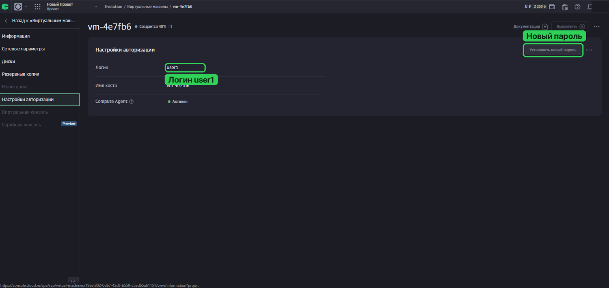

### Способ 2: SSH с ключом (для тех, кто привык к терминалу)

1. На своём компьютере (PowerShell или Терминал) создайте ключ: `ssh-keygen -t ed25519` (все вопросы можно пропустить клавишей Enter).
2. Покажите открытую часть: `type $env:USERPROFILE\.ssh\id_ed25519.pub` (Windows) или `cat ~/.ssh/id_ed25519.pub` (Mac и Linux) и скопируйте строку.
3. Добавьте её на сервер через виртуальную консоль (способ 1):
   ```
   mkdir -p ~/.ssh && echo 'ВСТАВЬТЕ_СЮДА_СКОПИРОВАННУЮ_СТРОКУ' >> ~/.ssh/authorized_keys && chmod 700 ~/.ssh && chmod 600 ~/.ssh/authorized_keys
   ```
4. С компьютера: `ssh user1@ВАШ_IP`, затем `sudo -i`.

Либо при создании машины выберите метод аутентификации **«Публичный ключ»** вместо «Пароль» (шаг 2 из 2) и вставьте открытый ключ туда.

---

## Шаг 6. Установите панель

Всё дальше по [основной инструкции](INSTALL.md): сразу с **[шага 5. Установите панель](INSTALL.md#5-установите-панель)** (подключение вы уже сделали). Короткая версия: [установка за 10 минут](QUICKSTART.md).

---

## Не потратить бонусы зря

- Следите за остатком: вверху справа плашка с бонусами, подробности в «Контроле затрат».
- **Удаляйте тестовые машины.** Созданная ВМ обычно расходует бонусы, пока существует (диск и адрес тарифицируются, даже если вы ею не пользуетесь). Лишнюю машину можно удалить из её карточки или списка через меню «⋯».
- Не пополняйте баланс, если не готовы платить: пока он не активирован, списывают только бонусы.
- Сохраняйте бэкапы миров к себе на компьютер: если машину удалят или бонусы кончатся, всё на ней пропадёт.

Застряли? Бот-помощник **[@faqmcpanel_bot](https://t.me/faqmcpanel_bot)** в Telegram подскажет, а канал разработчика: [t.me/huicoding](https://t.me/huicoding).
